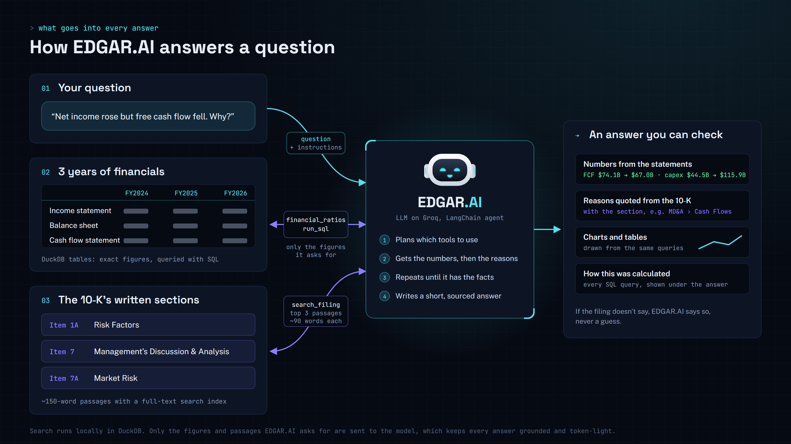
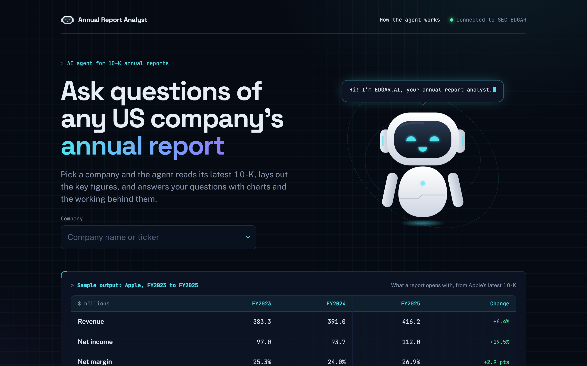
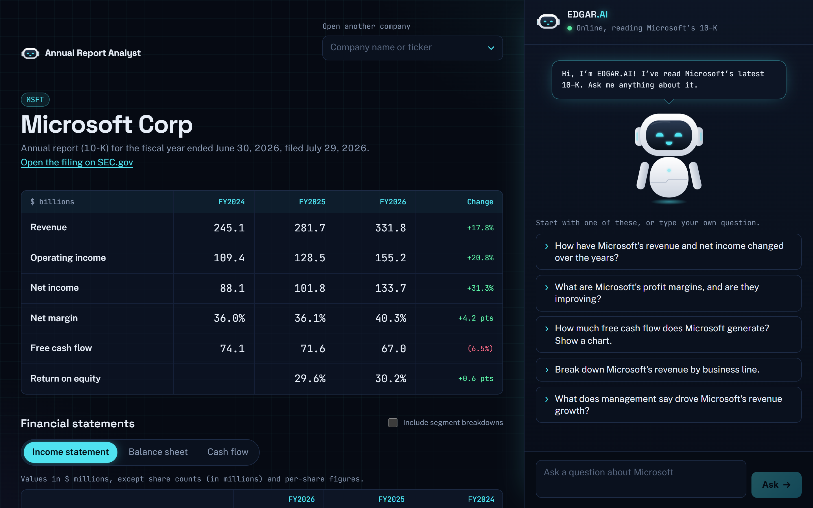
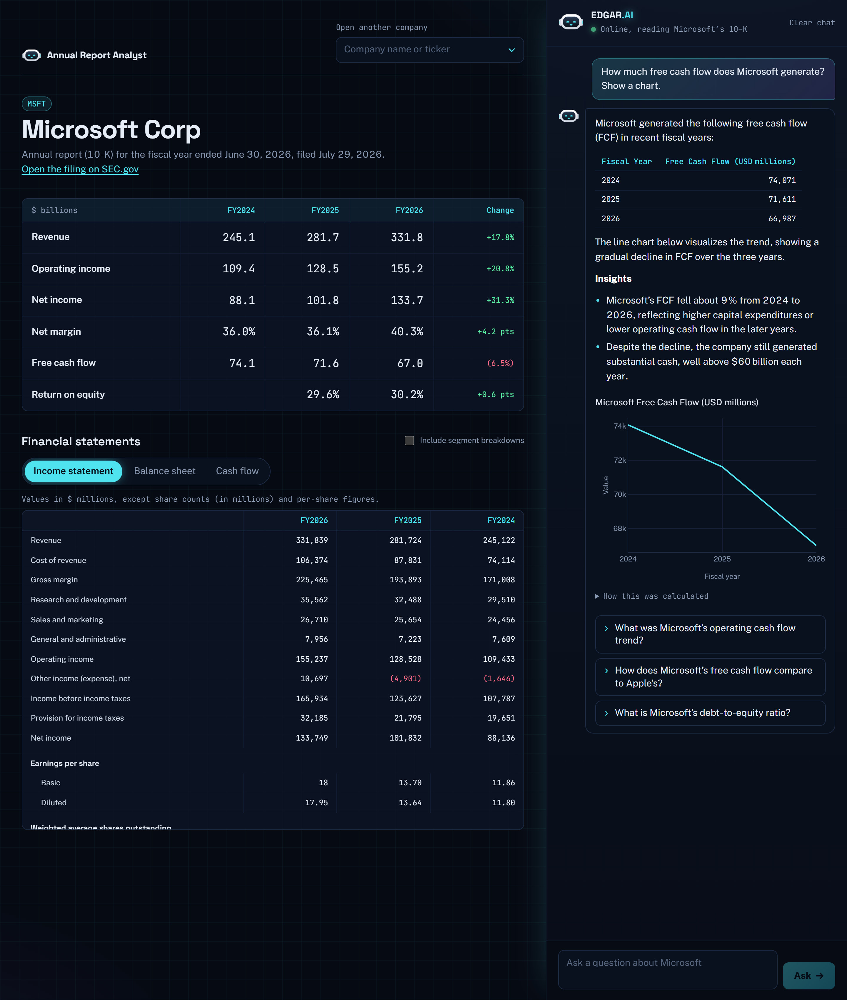
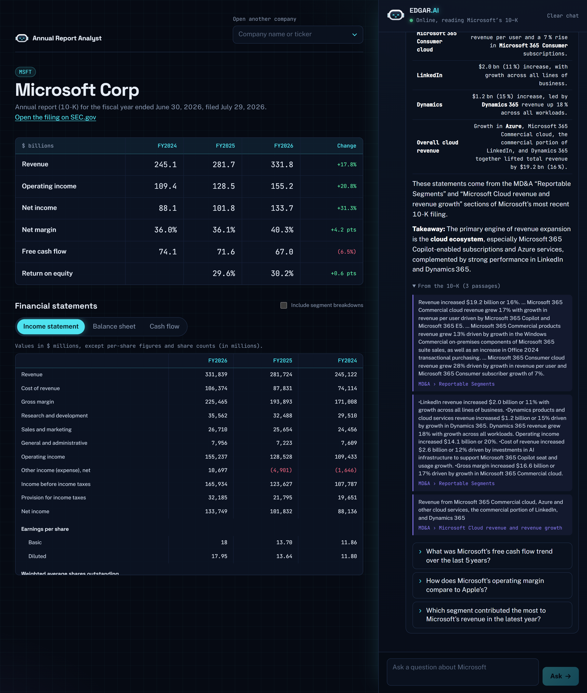
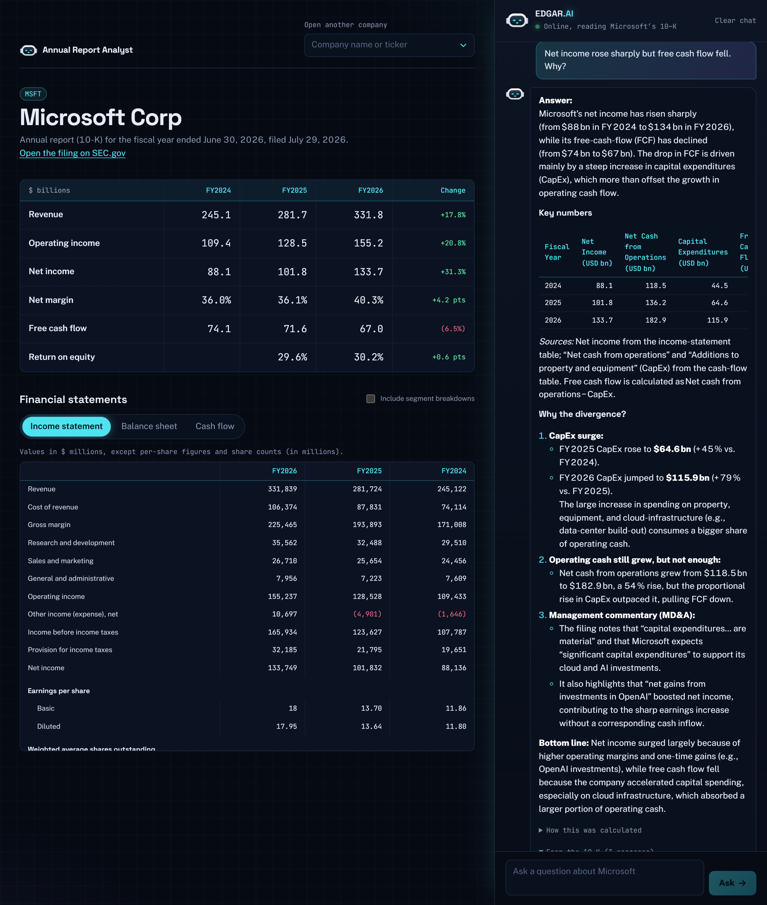
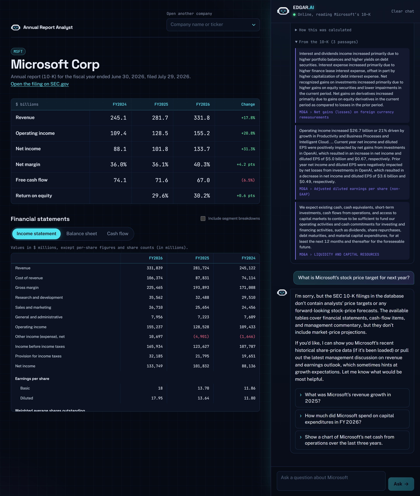

# EDGAR.AI: ask questions of any US company's annual report

Pick a US-listed company and EDGAR.AI reads its latest annual report (10-K) from SEC EDGAR.
It lays out the key figures, then answers your questions in plain English with tables, charts and
quotes from the filing, and shows exactly how each answer was calculated.

Built with a LangChain agent on a Groq-hosted LLM, DuckDB, FastAPI and React.



EDGAR.AI isn't handed the whole 10-K. For each question it pulls only what it needs: exact figures from
three years of financial statements (via SQL and a ratios tool) and the three most relevant passages from the
written sections: **Item 1A Risk Factors**, **Item 7 Management's Discussion & Analysis** and **Item 7A Market Risk**.
That keeps answers grounded in the filing and light on tokens.

## Screenshots

| | |
|---|---|
|  |  |
| **Home:** pick any US company | **Report:** key figures and statements, no AI needed |
|  |  |
| *"How much free cash flow does Microsoft generate? Show a chart."* | *"What does management say drove Microsoft's revenue growth?"*, quoting the MD&A |
|  |  |
| *"Net income rose sharply but free cash flow fell. Why?"* | *"What is Microsoft's stock price target?"*: says what the filing can't answer |

More in [`demo-screenshots/`](demo-screenshots/), with the demo order in [`SHOTS.md`](demo-screenshots/SHOTS.md).

## Features
- **Any US company**: search by name or ticker; the app fetches the latest 10-K from SEC EDGAR
  (US filers only; foreign companies file 20-F reports, which aren't supported).
- **Company view (no AI needed)**: key figures across the years, the three statements as readable
  tables, and suggested questions tailored to the company.
- **Ask in plain English**: EDGAR.AI plans, calls tools, checks the results and answers, with
  follow-up questions remembered ("now only for 2025").
- **Reads the written 10-K**: risk factors, MD&A and market risk are split into passages with a
  full-text index; for "why" questions EDGAR.AI quotes management's own explanation, with the section.
- **Financial ratios**: margins, growth, ROE/ROA, current ratio, debt-to-equity and free cash flow,
  calculated consistently and showing which line items were used.
- **Charts**: bar, line, pie, scatter, histogram, box and area charts from the same queries.
- **Transparent and safe**: every answer shows its SQL; only read-only queries are allowed; when the
  filing doesn't answer something, EDGAR.AI says so instead of guessing.
- **Animated assistant**: the EDGAR.AI robot listens while you type, thinks while it works, and
  cheers when an answer arrives.

## How it works
```
Question ─► LangChain agent (Groq LLM)
               │  tools: list_tables · find_line_items · financial_ratios · run_sql · create_chart · search_filing
               ▼
            DuckDB (in-memory: the company's statements + 10-K passages with a full-text index)
               │  exact results, quoted passages
               ▼
Answer + chart + sources + "how this was calculated", shown in the React app
```

| File | Purpose |
|---|---|
| `frontend/` | React (Vite + TypeScript) web app: home page, report view, EDGAR.AI chat |
| `server.py` | FastAPI backend the web app talks to; also serves the built app |
| `agent.py` | LangChain agent, system prompt, and the 6 tools |
| `sec_fetcher.py` | Ticker → latest 10-K on SEC EDGAR → statement tables and the main document |
| `data_loader.py` | Reshapes statement pages into long tables and loads them into DuckDB |
| `filing_text.py` | The 10-K's written sections → passages, full-text index and search |
| `financial_ratios.py` | Standard ratios from the statement tables |
| `company_view.py` | Key figures, readable statements and suggested questions (no AI) |

## Run it
```bash
py -m venv .venv
.venv\Scripts\activate
pip install -r requirements.txt
copy .env.example .env      # then paste your key from https://console.groq.com/keys

cd frontend && npm install && npm run build && cd ..
uvicorn server:app --port 8010
```
Open http://localhost:8010 and pick a company (or go straight to
http://localhost:8010/report?company=MSFT).

While changing the front end, also run `npm run dev` in `frontend/` and open http://localhost:5173;
it forwards `/api` calls to the backend on port 8010.

## Tips
- The model defaults to `openai/gpt-oss-120b`; set `GROQ_MODEL` in `.env` to change it.
  `qwen/qwen3.8-27b` also passed testing; avoid small models like `allam-2-7b` for tool calling.
- Groq's free tier has low tokens-per-minute limits. EDGAR.AI waits and retries automatically;
  if you ask several questions back to back, give it a minute between them.
- Some banks (e.g. JPMorgan) put their MD&A in a separate exhibit, so only their risk factors are searchable.

Inspired by [awesome-llm-apps / ai_data_analysis_agent](https://github.com/Shubhamsaboo/awesome-llm-apps/tree/main/starter_ai_agents/ai_data_analysis_agent),
rebuilt with LangChain, Groq, SEC EDGAR data and a React front end.
